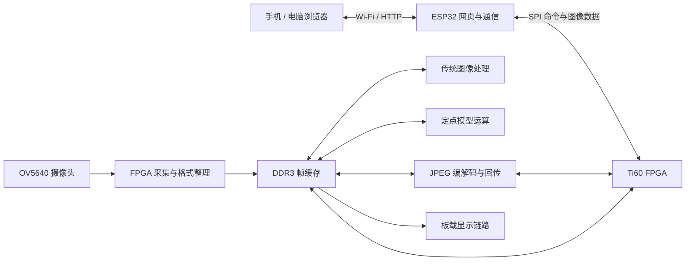

# 基于 Ti60 FPGA 的屏摄图像增强与文档处理系统

> 2026 全国大学生嵌入式芯片与系统设计竞赛 · FPGA 创新设计赛道 · 易灵思平台
>
> 硬件：VF-Ti60F225 + OV5640 + ESP-32D 

## 作品简介

拍摄投影、显示屏和纸质资料时，图像常出现摩尔纹、明暗不均、偏色和文字边缘不清等问题。本作品围绕课堂课件记录、会议屏摄和文档采集，设计了一套集图像采集、板端处理、无线交互和结果导出于一体的图像处理系统。

系统以 Ti60 FPGA 为计算与存储中心，既可以采集板载 OV5640 摄像头画面，也可以接收手机、电脑上传的图片。用户通过浏览器选择原图、灰阶、扫描文档、彩色增强或模型处理流程，查看处理结果并下载保存。系统另集成人像提取和视频调焦入口。

FPGA 承担图像数据通路、DDR 帧缓存、传统图像处理、定点模型计算和 JPEG 编解码等核心工作。ESP32 提供 Wi-Fi、HTTP 网页和 SPI 桥接；浏览器完成文件选择、交互展示及明确区分的图像后处理。模型主计算在 FPGA 板端执行，无需云端推理服务。

## 赛事要求与作品设计的对应关系

| 需要说明的问题 | 本作品的设计与评审入口 |
| --- | --- |
| 解决什么实际问题 | 面向屏摄与文档采集，改善纹理干扰、照明和可读性，并提供原图对照 |
| FPGA 承担什么核心功能 | 采集与缓存调度、图像处理、定点模型运算、JPEG 编解码和数据搬运 |
| 如何形成完整系统 | 摄像头或本地图片输入，经板端处理后，在网页查看、对比并导出 |
| 如何进行软硬件分工 | FPGA 计算与存储，ESP32 通信，浏览器交互|
| 相比基础例程新增了什么 | 从摄像头/DDR/显示基础工程扩展为双输入、多处理流程、模型运算与无线结果回传系统 |


## 主要功能与使用场景

| 功能 | 使用方式与输出 |
| --- | --- |
| 摄像头抓拍 | 选择 720p、1080p 或 720p 预览/1080p 抓拍；720p 档实际导出为 **1024×600**，1080p 档导出为 **1920×1080** |
| 本地图片处理 | 上传已有屏摄或文档图片，按 **256×224、1024×600、1920×1080** 三档尺寸处理 |
| 传统图像处理 | 提供原图、灰阶、扫描文档和彩色增强，可组合灰阶曲线、色度平滑、中值去噪等选项 |
| 模型与联合处理 | 在 FPGA 中执行共享模型，选择彩色、灰阶或文字输出；联合流程衔接传统处理 |
| 原图与结果对照 | 保留任务身份与校验信息，支持下载、继续读取及浏览器内对比 |
| 人像提取 | FPGA 推理产生 64×64 掩码，浏览器按原图分辨率合成透明背景结果，并提供边缘修整；当前修复状态见下文 |
| 视频调焦 | 提供 512×300 预览入口，辅助摄像头位置与清晰度调整 |

三档尺寸是本地图片/整帧处理尺寸，并不表示人像网络按这些尺寸直接推理。摄像头采集档位、板端处理尺寸和最终导出尺寸也分别定义。

## 系统架构



### FPGA 计算与存储

摄像头数据进入采集通路后写入 DDR；上传图片通过 SPI 接收并进入解码和帧缓存路径。处理模块按任务选择输入、输出地址和尺寸，通过共享内存接口读取原图并写回结果。JPEG 通路负责压缩回传，降低浏览器获取图像时的数据量。

模型通路使用定点数据和片上计算资源。共享整帧模型将卷积计算与非卷积操作分工：专用运算模块执行主要卷积，FPGA 内 PicoRV32 处理器运行配套整数程序完成部分非卷积任务。这里使用的是第三方处理器核，作品工作集中在计算模块、程序、存储访问和整机集成，不宣称自研 RISC-V 核。

### ESP32 通信与任务管理

ESP32 管理设备热点、网页请求、SPI 控制和数据传输，提供任务查询、输入/结果校验和断线后的继续读取能力。人像输入采用分批装载，使数据发送期间仍可响应状态查询。

## 设计特点

1. **采集和上传共用处理系统。** 摄像头抓拍与本地图片接入相同的板端处理和回传机制，便于同一素材复现对照。
2. **传统算法与模型分工。** 传统处理负责可控的局部增强与文档收尾，模型提供学习得到的特征变换，并允许组合为联合流程。
3. **面向 FPGA 的整数计算。** 通过定点表示、专用计算模块及板内处理器协同，组织模型运算和 DDR 数据访问。
4. **无线交互和结果完整性。** 手机无需安装专用应用，通过热点访问设备；回传保留任务身份、长度及 CRC 检查。

## 复现与演示

### 1. 准备硬件与工具

使用 VF-Ti60F225 开发板、OV5640 DVP 摄像头、ESP32，以及工程所配套的显示与供电连接。接线按板卡原理图、工程外设配置和 ESP32 主程序中的引脚定义核对。

FPGA 使用 Efinity **2025.2.288.3.8**；ESP32 使用 Arduino ESP32 Core **3.1.1**，开发板选择 ESP32 Dev Module，FQBN 为 `esp32:esp32:esp32`。

### 2. 烧录配套固件

| 目标 | 固件入口 | Flash 地址 |
| --- | --- | --- |
| ESP32 引导程序 | [bootloader.bin](firmware/esp32/bootloader.bin) | `0x1000` |
| ESP32 分区表 | [partitions.bin](firmware/esp32/partitions.bin) | `0x8000` |
| ESP32 应用 | [application.bin](firmware/esp32/application.bin) | `0x10000` |
| FPGA 配置 Flash | [完整 BIN](firmware/fpga/fpga_configuration_and_model.bin) 或 [原生 HEX](firmware/fpga/fpga_configuration_and_model.hex) | `0x0` |

FPGA 完整 BIN 为 8 MiB，包含从 `0x140000` 起始的模型区；HEX 采用 Efinity 每行 1 字节的原生格式。已有相同引导和分区的 ESP32 可只更新应用，保留 NVS。

### 3. 运行演示

1. 设备上电，连接热点 **Ti60-Capture**，密码 **ti60capture**，访问 [http://192.168.4.1](http://192.168.4.1)。
2. 在拍照页面选择采集档位和处理方式，抓拍并保存原图/结果，说明导出尺寸。
3. 在本地图片页上传同一张屏摄或文档图，对比不同处理选项；再进入模型页对比模型与联合流程。
4. 下载结果并保留任务校验信息；速度测试应区分上传、板端处理、回传和网页耗时。

### 4. 从源码构建

仓库只保留三个主要目录：`esp32/` 为通信与网页源码，`fpga/` 为硬件工程及模型运行数据，`firmware/` 为可烧录镜像。

FPGA：在仓库根目录先更新 IP 路径，再用 Efinity 打开[工程入口](fpga/Ti60_Demo_frame_ddr.xml)。

```powershell
python fpga/pc_tools/prepare_project_paths.py
```

ESP32：用 Arduino IDE 打开[主程序](esp32/esp32_fpga_spi_bridge/esp32_fpga_spi_bridge.ino)，保留同目录全部头文件及分区表；或运行：

```powershell
arduino-cli compile --fqbn esp32:esp32:esp32 --build-path ./build/esp32 ./esp32/esp32_fpga_spi_bridge
```

普通 FPGA 构建使用预置的板内程序初始化文件。只有修改板内 RISC-V 的 C/汇编程序时，才需在 Linux/WSL 使用支持 RV32IM/ILP32 的裸机 GCC 运行其 `build.sh`，随后重建 FPGA。

模型权重、运行指令、ROM/RAM 初始化内容和 IP 配置必须随工程保留。网页原始源码在 `esp32/web_sources/`，设备实际加载的资源位于 Arduino 工程的头文件中；修改网页原始文件后需同步内嵌资源。

